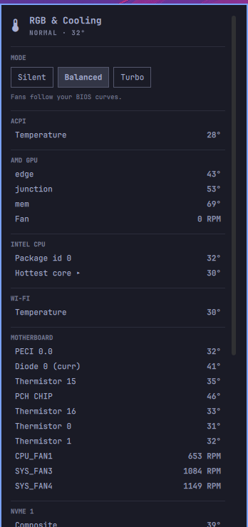

# Omarchy RGB & Cooling



Omarchy bar and panel for hardware temperatures and fan RPM. Rename sensors,
view RGB device status, and select **Silent**, **Balanced** or **Turbo** through
`power-profiles-daemon`. These modes change the system power profile; the BIOS
continues to control fan curves. Motherboard fan names are shown only when an
exact-board entry is verified in [`data/fan-headers.json`](data/fan-headers.json).

RGB: install the engine your hardware needs from the panel's **Engines** tab
(one button, your password through the Omarchy dialog), then enable each device
in the **Lighting** tab. Only a static colour and brightness are sent, nothing
is saved to the device, and OpenRGB runs sandboxed seeing only the devices you
enabled.

## Scope

- Reads hwmon temperatures and fan RPM as the logged-in user.
- Does not write PWM or hardware registers and never runs as root. Packages
  are installed only from the Engines tab, from a closed list, with your password.
- Uses a socket-activated `systemd --user` core. `power-profiles-daemon` is
  optional; power modes are unavailable without it.

## Requirements

- Omarchy 4.x with its plugin system and Quickshell.
- Qt 6 base, a C++20 compiler, and `pkg-config` to build the core
  (`Qt6Core`, `Qt6Network`, `Qt6DBus`, and `libudev`).
- A working `systemd --user` session.
- Optional: `power-profiles-daemon` for Silent, Balanced, and Turbo.
- For RGB: `bubblewrap` (sandbox) and OpenRGB, installable from the Engines tab.

These requirements were checked against Omarchy 4.0.6, Quickshell 0.3.2,
Qt 6.12, GCC 16.2, and systemd-libs 262.1 on the reference system.

## Install and remove

```sh
omarchy plugin add https://github.com/gsus67/omarchy-rgb-cooling.git --enable
```

The first time the widget loads it builds the core (about 30 seconds) and
enables its user socket. It does not install packages or use `sudo`. If the
widget does not appear after installing, run `omarchy restart shell`.

To remove it, run `uninstall.sh` from the installed plugin directory:

```sh
bash ~/.config/omarchy/plugins/io.github.gsus67.omarchy-rgb-cooling/uninstall.sh
```

This removes the plugin checkout, its user units, the built core, its state,
the runtime socket, your settings in `$XDG_CONFIG_HOME/omarchy-rgb-cooling/`
(sensor names, enabled devices) and the engines it installed (it asks for your
password; packages you had before are never removed). Add `--keep-settings` to
keep your settings. See [API and footprint](docs/API.md#footprint-what-the-plugin-adds-to-a-system).

## Optional hardware setup

### MSI NCT6687D motherboard sensors

The in-tree `nct6683` driver may expose MSI NCT6687D sensor readings. Loading
it is optional and does not enable fan control. First try it temporarily:

```sh
sudo modprobe nct6683 force=1
```

To load it persistently, add one module name and its option in separate files:

```sh
echo nct6683 | sudo tee /etc/modules-load.d/omarchy-rgb-cooling.conf
echo 'options nct6683 force=1' | sudo tee /etc/modprobe.d/omarchy-rgb-cooling.conf
```

To reverse the persistent setup and unload the driver:

```sh
sudo rm /etc/modules-load.d/omarchy-rgb-cooling.conf /etc/modprobe.d/omarchy-rgb-cooling.conf
sudo modprobe -r nct6683
```

Reboot also clears a temporary load. Keep fan curves in BIOS; do not use
`acpi_enforce_resources=lax/no` or write PWM values. See
[`docs/FAN_CONTROL_RESEARCH.md`](docs/FAN_CONTROL_RESEARCH.md).

### RGB

The Engines tab installs OpenRGB (`openrgb`, about 10 MiB; Arch has no
headless-only package, but the plugin only runs its server, never its window).
OpenRGB starts only when an enabled device needs it, inside `bwrap` with access
to nothing but those devices (no I²C/SMBus, no other HID devices), listening on
127.0.0.1, and stops after two idle minutes. Devices are listed from OpenRGB's
udev rules without running it, because some detectors initialise a device as
soon as they open it. A Thermalright Trofeo (`0416:5302`, used by
omarchy-trcc) is always excluded. Requires `bubblewrap`.

## Hardware support

Support advances through four evidence levels:

| Level | Meaning |
|---|---|
| `recognized` | Device identity is detected. |
| `upstream-supported` | The upstream engine or driver documents that device. |
| `simulation-tested` | The adapter passed against simulated hardware. |
| `physically-tested` | The feature was exercised on the physical device. |

| Hardware tested | Physical result |
|---|---|
| MSI B760 GAMING PLUS WIFI (MS-7D98), NCT6687D | Temperature and fan RPM readings; verified fan header names. |
| Same system, power profiles | Silent, Balanced, and Turbo selection through `power-profiles-daemon`; BIOS retains fan control. |

Other devices may have a lower support level. See
[`docs/INVENTORY.md`](docs/INVENTORY.md) and the verified
[`fan header table`](data/fan-headers.json).

## Troubleshooting

- **Widget missing:** run `omarchy restart shell`.
- **Core errors:** inspect `journalctl --user -u omarchy-rgb-cooling`.
- **Motherboard sensors missing:** confirm the NCT6687D driver is loaded with
  the optional `modprobe` step above, then check the kernel log for ACPI or
  resource conflicts. The board may expose no sensor node under the current
  kernel driver.

More: [API and footprint](docs/API.md) · [Security](SECURITY.md) ·
[Contributing](CONTRIBUTING.md) · [Licenses](LICENSES.md).
